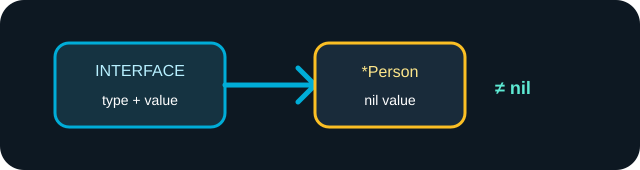

<div align="center">


[](LICENSE)

[](https://github.com/CyberLoop-dev/go-interface-nil-lab/stargazers)




</div>

## 🧭 Overview
A tiny Go command-line demonstration of the typed-nil interface gotcha. It shows why an interface containing a nil pointer is not itself equal to `nil`.

## ✨ Features
- 🧩 Compares a nil interface with an interface holding a typed nil pointer.
- 🔎 Prints the interface's dynamic type and underlying pointer state.
- 🛡️ Demonstrates a nil-safe pointer-receiver method.
- 📦 Supports readable and JSON output.

## 🖥️ Demo
Run the example locally with Go; no hosted demo is configured.

## 🚀 Quick Start
```bash
go run .
go run . --json
go test ./...
```

## 🧰 Tech Stack
- Go 1.22+
- Standard library: `flag`, `reflect`, `encoding/json`

## 🗂️ Folder Structure
```text
.
├── assets/mark.svg
├── main.go
├── main_test.go
├── go.mod
└── README.md
```

## 🗺️ Roadmap
- [ ] Add examples with multiple interface methods.
- [ ] Compare value and pointer receiver method sets.
- [ ] Add a short escape-analysis companion example.

## 🤝 Contributing
Add small, compilable examples with tests and explain the exact Go rule being demonstrated.

## 📄 License
MIT. See [LICENSE](LICENSE).

<div align="center">


</div>
